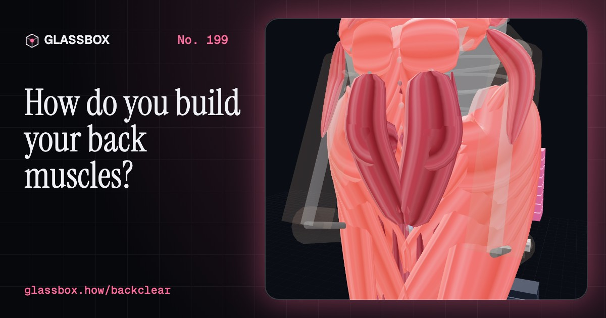
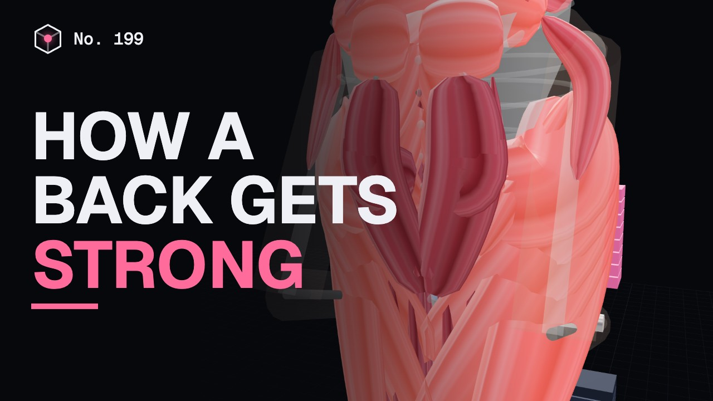
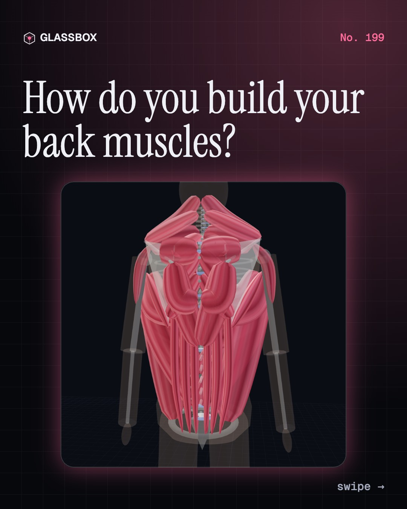
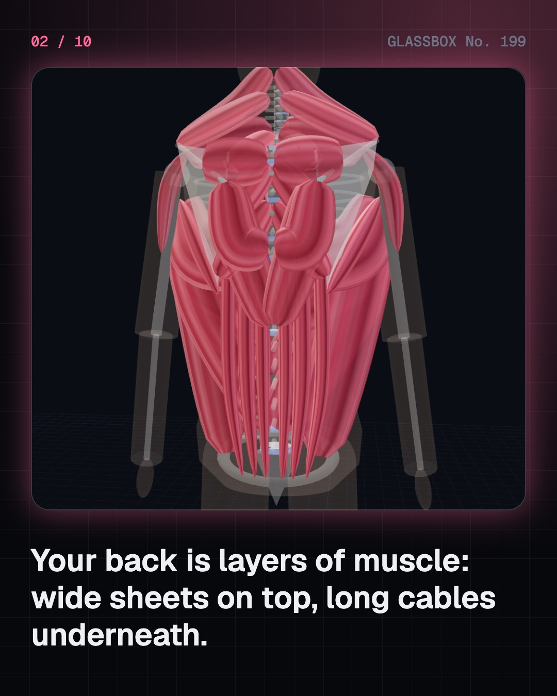
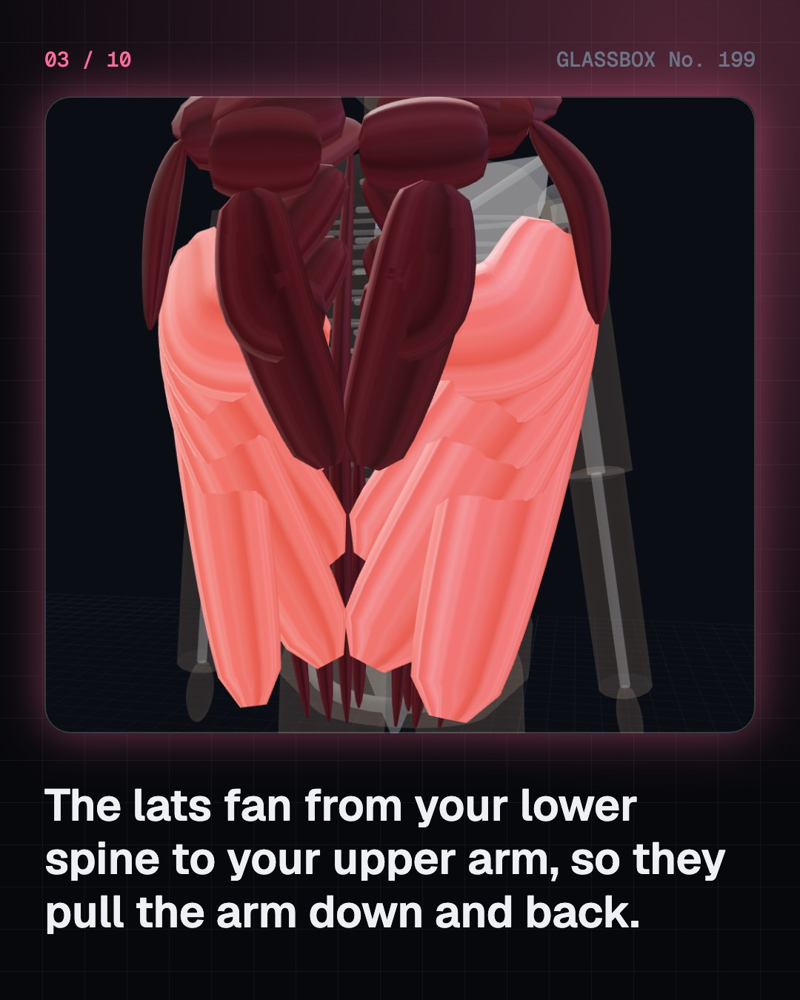
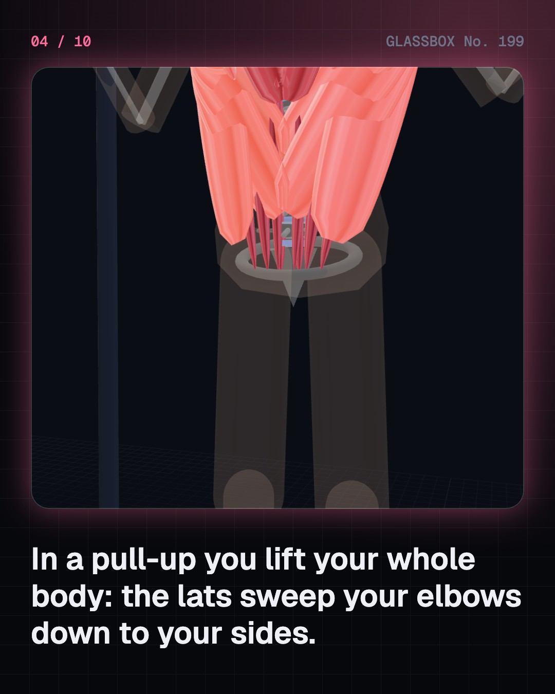

<!-- glassbox:start -->
<!-- Generated from glassbox.json by the Glassbox hub (npm run readme -- backclear). Edit glassbox.json, not this block. -->
<p align="center"><a href="https://glassbox.how/e/backclear/"></a></p>

<h1 align="center">BackClear</h1>

<p align="center"><b>How do you build your back muscles?</b><br>In a pull-up you lift your whole body, and in a deadlift your back muscles pull thousands of newtons from 5.5 cm behind your spine. Peel the back's layers, pick a grip and watch which muscles shorten, work out the lever on your lowest disc, and learn how to train it safely.</p>

<p align="center"><a href="https://glassbox.how/backclear/"><b>▶ Play with it</b></a> &nbsp;·&nbsp; <a href="https://glassbox.how/e/backclear/">Read the 60-second explainer</a> &nbsp;·&nbsp; <a href="https://glassbox.how/backclear/glassbox/reel.mp4">Watch the 40-second video</a></p>

<p align="center">
  <a href="https://glassbox.how/e/backclear/"></a>
  <a href="https://glassbox.how/e/backclear/"></a>
  <a href="LICENSE"></a>
  <a href="LICENSE-CONTENT.md"></a>
  <a href="#privacy"></a>
</p>

## In 60 seconds

1. **A back is a stack of muscles.** Wide sheets on top (trapezius and the latissimus dorsi, which runs from your lower spine to the front of your upper arm), rhomboids and teres major beneath, and the erector spinae and multifidus running beside 24 vertebrae and their discs.
2. **Where your elbows go decides what works.** Pulling down (pull-ups, pulldowns) shortens the lats and teres major most; rows squeeze the shoulder blades together with the rhomboids and middle trapezius. A pull-up lifts all of your body weight; bands, negatives, pulldowns and inverted rows (about two thirds of you when level) build up to it.
3. **A deadlift is a lever.** The moment on your lowest disc is each weight times its horizontal distance from it. The back muscles pull only about 5.5 cm behind the spine, so a 100 kg bar needs about 7 kN from them. Let the bar drift 15 cm forward and the moment rises by about a third: keep it close, brace, keep a neutral spine.
4. **How it grows.** Hard sets near failure, about 10 or more a week per muscle, two or more days a week (WHO), a little more over time, about 0.83 g of protein per kg a day from food (ICMR-NIN), and sleep. Strength comes first from your nerves; size takes weeks to months.
5. **Posture myths and back pain.** No single posture is proven to prevent back pain: move often. Low back pain is the world's leading cause of disability, and exercise is part of its treatment (WHO, NHS, Cochrane).
6. **Train safely.** Ask a doctor first with heart disease, high blood pressure, pregnancy or a recent injury. Start light, technique first, stop on sharp pain or pain spreading down a leg, and know the NHS red flags. Anabolic steroids are harmful and banned.

## Words worth knowing

| Term | Meaning |
|---|---|
| **Latissimus dorsi** | The widest back muscle; it pulls the arm down and back. |
| **Trapezius** | A diamond of muscle from skull to mid-back that lifts, squeezes and lowers the shoulder blades. |
| **Erector spinae** | Long columns of muscle beside the spine that straighten and hold it. |
| **Scapular retraction** | Pulling the shoulder blades towards the spine, as in a row. |
| **Hip hinge** | Bending by folding at the hips with a fairly straight back. |
| **Moment** | A turning effect: force times its distance from the pivot. |
| **Neutral spine** | The spine with its natural curves, neither rounded nor arched hard. |
| **Progressive overload** | Slowly asking more of a muscle over weeks: more reps, weight or sets. |
| **Red flag** | A warning sign with back pain that needs urgent medical help. |

## A short history

**From wrestlers' poles and ropes in India to a pressure needle inside a living disc, and the evidence that exercise helps back pain.**

- **1135** · Mallakhamb is written down (King Someshvara III, Western Chalukya kingdom, Karnataka)
- **1680** · The body as a set of levers (Giovanni Alfonso Borelli, Rome)
- **1810** · Mallakhamb is revived (Balambhatta Dada Deodhar, Maharashtra)
- **1928** · Surya Namaskar gets its name (Bhawanrao Shriniwasrao Pant Pratinidhi, Raja of Aundh, Aundh)
- **1964** · A needle inside a living disc (Alf Nachemson and James Morris, Sweden and USA)
- **1991** · The loads in record lifts (Jacek Cholewicki, Stuart McGill and Robert Norman, University of Waterloo)
- **1999** · Disc pressure in daily life (Hans-Joachim Wilke and colleagues, Ulm)
- **2023** · WHO's first back pain guideline (World Health Organization, Geneva)

The full story, with 29 moments, charts, people and 25 sources: [glassbox.how/e/backclear/history](https://glassbox.how/e/backclear/history/). The data lives in [`history.json`](history.json).

## Video and slides

Made with the Glassbox studio from this box's storyboard (`window.glassbox.director`). Free to reuse under CC BY 4.0.

<a href="https://glassbox.how/backclear/glassbox/video.mp4"></a>

<p><a href="glassbox/slide-1.jpg"></a> <a href="glassbox/slide-2.jpg"></a> <a href="glassbox/slide-3.jpg"></a> <a href="glassbox/slide-4.jpg"></a></p>

| File | What | Size |
|---|---|---|
| [`glassbox/reel.mp4`](https://glassbox.how/backclear/glassbox/reel.mp4) | Reel / Short, with captions and soundtrack | 1080×1920 |
| [`glassbox/video.mp4`](https://glassbox.how/backclear/glassbox/video.mp4) | YouTube video, with captions and soundtrack | 1920×1080 |
| `glassbox/slide-1…10.jpg` | Instagram carousel | 1080×1350 |
| `glassbox/thumb.jpg` | YouTube thumbnail | 1280×720 |
| `glassbox/cover.jpg` | Share card and repo social preview | 1200×630 |
| [`glassbox/history-reel.mp4`](https://glassbox.how/backclear/glassbox/history-reel.mp4) | “History in 10 moments” Reel / Short | 1080×1920 |
| `glassbox/history-slide-*.jpg` | History carousel | 1080×1350 |
| `glassbox/post.json` | Post copy and schedule used by the publish kit | |

## Privacy

This box has no accounts and no ads, and it ships its own fonts and libraries. When you run it yourself it sends nothing anywhere. On glassbox.how, the site's `/bar.js` also loads Glassbox's analytics: **Google Analytics** to count visits (it asks first in the EU, UK and Switzerland, and stays off when your browser sends Global Privacy Control or Do Not Track) and **ClickTrust** to detect bots.

It remembers a few things **in your own browser only**, and never sends them anywhere:

| Browser storage key | What it holds |
|---|---|
| `backclear.v1` | Which chapters you have opened, your best quiz scores, and sound on or off. |

Exactly what each one sees is at [glassbox.how/privacy](https://glassbox.how/privacy/).

## Licences

- **Code:** [MIT](LICENSE). Use it, change it, ship it.
- **Explanations, text, images and videos** (`glassbox.json`, `glassbox/`): [CC BY 4.0](LICENSE-CONTENT.md). Credit “Glassbox, glassbox.how/e/backclear”.
- **Third-party parts** keep their own licences: [three.js](https://threejs.org) (MIT), [Geist, Instrument Serif](https://openfontlicense.org) (SIL OFL 1.1).
- The Glassbox name and logo aren't covered by either licence. See the [terms](https://glassbox.how/terms/).

Found a mistake? [Open an issue](https://github.com/bdeeps/backclear/issues). Corrections happen in public.
<!-- glassbox:end -->

## Run it

It's plain HTML, CSS and JavaScript. No build step and no dependencies. Run locally, it contacts no other website.

```bash
python3 -m http.server 8000
```

Three.js and the fonts ship in `vendor/` and `fonts/`, so it also works offline.

Then open http://localhost:8000.

## How it's built

| File | What |
|---|---|
| `index.html`, `css/app.css` | The page and its styles |
| `js/app.js`, `js/stage.js`, `js/ui.js`, `js/kit.js` | The shared Glassbox 3D engine: chapters, 3D stage, controls, quiz, video director |
| `js/chapters/*.js` | One file per chapter: the 3D model, controls, text, key terms, quiz and video scenes |
| `js/back.js` | The shared models and numbers: a posable back seen from behind with flexible muscle bands, a side-on lifter with a lumbar spine and barbell, the pull and row loads, and the deadlift lever about the L5/S1 disc |
| `glassbox.json` | Title, question, explainer beats, key terms, browser storage and credits shown on glassbox.how |
| `reel` in each chapter | The storyboard the Glassbox studio records into short videos |
| `glassbox/` | The published video, slides, thumbnail and post copy |
| `fonts/`, `vendor/three/` | Self-hosted Geist and Instrument Serif (SIL OFL 1.1) and three.js (MIT) |
